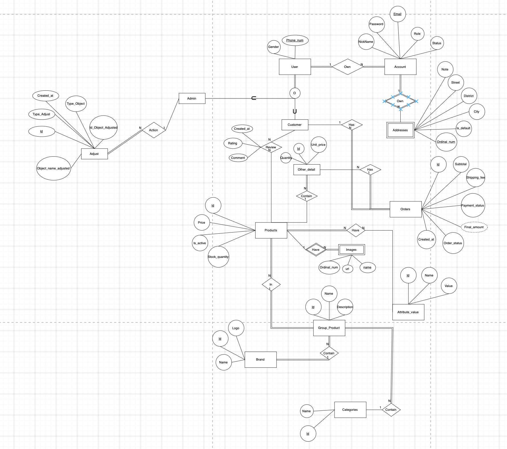

# Cơ Sở Dữ Liệu — Hệ Thống Quản Lý & Bán Quần Áo (KIKI)

Tài liệu tổng quan thiết kế cơ sở dữ liệu quan hệ phục vụ ứng dụng bán hàng thời trang **KIKI (Ecom-Clothe)** xây dựng bằng **Java 25 / Java Swing** kết nối qua **JDBC (`mysql-connector-j 8.3.0`)** theo kiến trúc `Model – DAO – Service – Controller`.

---

## 1. Hệ quản trị CSDL (DBMS) & Cấu hình

- **DBMS chính:** **MySQL 8.0+** (`InnoDB`, `CHARSET=utf8mb4`, `COLLATE=utf8mb4_bin`) — hỗ trợ đầy đủ Tables, Indexes, Views, Triggers và Stored Procedures.
- **Kết nối ứng dụng:** JDBC + `PreparedStatement`, hỗ trợ Transaction (`SELECT ... FOR UPDATE`, `commit`/`rollback`) ở tầng ứng dụng.

---

## 2. Sơ đồ Thực thể – Kết hợp Mở rộng (EER / ERD)



**Điểm nổi bật của mô hình:**
- **Kế thừa chồng lấp (Overlapping Specialization):** `User` phân rã thành `Admin` và `Customer` theo khóa `Phone_num`.
- **Thực thể yếu (Weak Entities):** `Address` phụ thuộc `Account` (`account_Email`, `Ordinal_num`); `Images` phụ thuộc `Products` (`Products_Id`, `Name`).
- **Thuộc tính dẫn xuất:** `Orders.Final_amount` được cài đặt bằng cột `VIRTUAL` (`Subtotal + Shipping_fee`).
- **Mức chuẩn hóa:** **14/16 bảng đạt BCNF**; 2 bảng `Orders` và `Adjust` dừng ở **2NF** theo lý thuyết do thiết kế có chủ đích (cột ảo `Final_amount` và lưu snapshot tên đối tượng trong nhật ký).

---

## 3. Quy mô & Thành phần CSDL

| Thành phần | Số lượng | Mô tả ngắn |
| :--- | :---: | :--- |
| **Tables** | **16** | `User`, `Admin`, `Customer`, `Account`, `Address`, `Categories`, `Brand`, `Group_Product`, `Products`, `Attribute_value`, `Have`, `Images`, `Orders`, `Other_detail`, `Review`, `Adjust` |
| **Indexes bổ sung** | **16** | Đánh theo các truy vấn `WHERE`, `JOIN`, `ORDER BY`, `GROUP BY` thực tế từ 8 lớp DAO |
| **Views** | **6** | `vw_product_catalog`, `vw_product_variant_details`, `vw_order_summary`, `vw_daily_revenue`, `vw_low_stock_products`, `vw_admin_adjust_log` |
| **Triggers** | **8** | Ràng buộc toàn vẹn `BEFORE INSERT/UPDATE` (giá, tồn kho, số lượng, trạng thái đơn/thanh toán, điểm đánh giá, vai trò) — không xung đột transaction trừ/hoàn kho trong Java |
| **Stored Procedures** | **6** | `sp_get_revenue_by_date_range`, `sp_get_top_selling_products`, `sp_get_low_stock_products`, `sp_search_product_groups`, `sp_get_customer_order_history`, `sp_restock_product_with_log` |
| **Truy vấn trong App** | **90** | Trích xuất từ 8 lớp `DAO` (`AccountDAO`, `AddressDAO`, `AdjustDAO`, `CatalogDAO`, `OrderDAO`, `ProductDAO`, `ReviewDAO`, `StatisticDAO`) |

---

## 4. Danh sách Indexes bổ sung

| Bảng | Tên Index | Cột được đánh Index | Mục đích tối ưu |
| :--- | :--- | :--- | :--- |
| `Orders` | `idx_orders_customer_created` | `(Customer_Phone_num, Created_at, Id)` | Lịch sử đơn hàng theo khách, sắp mới nhất |
| `Orders` | `idx_orders_payment_status_created` | `(Payment_status, Order_status, Created_at)` | Thống kê doanh thu & lọc đơn Admin |
| `Orders` | `idx_orders_status_created` | `(Order_status, Created_at)` | Đếm và lọc đơn theo trạng thái |
| `Products` | `idx_products_group_active_price` | `(Group_Product_Id, Is_active, Price)` | Tính `MIN(Price)` biến thể đang bán (covering index) |
| `Products` | `idx_products_stock_quantity` | `(Stock_quantity)` | Cảnh báo sản phẩm sắp hết hàng |
| `Group_Product` | `idx_group_product_cat_brand` | `(Categories_Id, Brand_Id)` | Lọc kết hợp danh mục + thương hiệu |
| `Group_Product` | `idx_group_product_name` | `(Name)` | Tìm kiếm và sắp xếp theo tên nhóm sản phẩm |
| `Review` | `idx_review_product_created_rating` | `(Products_Id, Created_at, Rating)` | Lấy đánh giá mới nhất & tính `AVG(Rating)` |
| `Images` | `idx_images_product_ordinal` | `(Products_Id, Ordinal_num, url)` | Lấy ảnh đại diện / danh sách ảnh theo thứ tự |
| `Address` | `idx_address_email_default` | `(account_Email, Is_default, Ordinal_num)` | Truy xuất nhanh địa chỉ mặc định |
| `Adjust` | `idx_adjust_admin_created` | `(Admin_Phone_num, Created_at, Id)` | Lọc nhật ký thao tác theo Admin và thời gian |
| `Adjust` | `idx_adjust_created` | `(Created_at, Id)` | Hiển thị toàn bộ nhật ký mới nhất trước |
| `Other_detail` | `idx_other_detail_order_product` | `(Orders_Id, Products_Id, Quantity)` | Kiểm tra đã mua hàng & top sản phẩm bán chạy |
| `Attribute_value` | `idx_attr_name_value` | `(Name, Value)` | Sắp xếp và tra cứu cặp thuộc tính – giá trị |
| `Categories` | `idx_categories_name` | `(Name)` | Tra cứu danh mục theo tên |
| `Brand` | `idx_brand_name` | `(Name)` | Tra cứu thương hiệu theo tên |

---

## 5. Cấu trúc thư mục SQL & Chạy nhanh

```text
sql/
├── 01_schema.sql               # Khởi tạo DB, 16 bảng và 16 indexes
├── 02_views.sql                # 6 Views báo cáo & tổng hợp
├── 03_triggers.sql             # 8 Triggers kiểm tra toàn vẹn (MySQL 8.0)
├── 04_procedures.sql           # 6 Stored Procedures (MySQL 8.0)
├── all_in_one.sql              # Tổng hợp lệnh SQL tạo toàn bộ schema, views, triggers và procedures
└── app_queries.sql             # Tổng hợp 90 câu lệnh SQL từ tầng DAO
```
